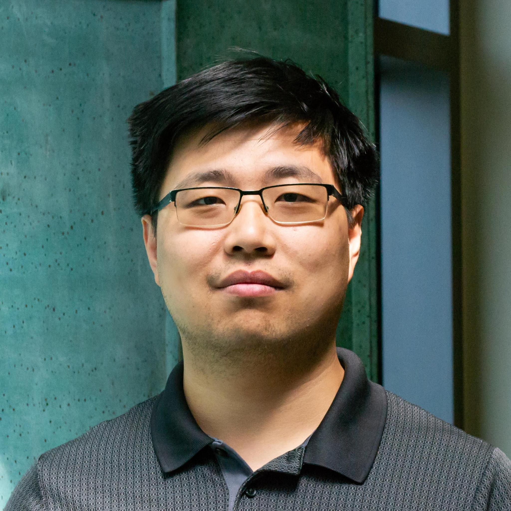

# About 

Hi, I’m David. I’m a postdoctoral researcher in [Monika Henzinger’s group](https://ista.ac.at/en/research/henzinger_monika-group/) at the Institute of Science and Technology Austria (ISTA). I work in theoretical computer science with a focus on graph algorithms and computational geometry.

I received my PhD in computer science from the University of Illinois Urbana-Champaign in 2025, advised by [Timothy M. Chan](https://tmc.web.engr.illinois.edu/). My dissertation received the 2025 CCCG Best PhD Dissertation Award. Before that, I completed an MSc in computer science, advised by [Will Evans](https://www.cs.ubc.ca/~will/), and a BSc in combined honours computer science and mathematics at the University of British Columbia.

Email: [dzheng at institutename.ac.at](mailto:dzheng at ista dot ac point at) · [CV](/cv.html) (Last updated Nov 2026) · [Google Scholar](https://scholar.google.com/citations?user=whlzbc8AAAAJ&hl=en) · [DBLP](https://dblp.org/pid/87/10078.html)

---   

## Research 

A recurring theme in my research is using geometric structure to design faster algorithms.

**Graph algorithms using geometry**. I study distances and related problems in planar, minor-free, and geometric intersection graphs, including [diameter algorithms](https://arxiv.org/abs/2510.16346), [distance oracles](https://arxiv.org/abs/2410.12003), and [planar emulators](https://arxiv.org/abs/2510.21700).

**Computational and discrete geometry**. My work focuses primarily on [geometric range searching](https://doi.org/10.1137/1.9781611977073.10). I have also looked at incidence problems and [weak ε-nets](https://arxiv.org/abs/2610.40982v3).

**Combinatorial optimization**. I have also worked on approximation algorithms and data structures for [matching](https://doi.org/10.1007/978-3-031-32726-1_32), [submodular optimization](https://doi.org/10.4230/LIPIcs.ICALP.2023.74), and [TSP](https://arxiv.org/pdf/2611.09421).

---
## Service 

I serve on the program committees of ESA 2026 and SoCG 2027. I received an Outstanding Reviewer Award for SoCG 2025.

I also review for conferences and journals in theoretical computer science. A detailed service record is available in my [CV](/cv.html).

---
## Publications

### 2026



### 2025



### 2024



### 2023



### 2022



### 2021



### 2020



---
## News

**[Nov 2026]** New preprint: [Faster Planar Diameter using Pseudoline Envelopes](https://arxiv.org/abs/2611.05019), with Daniel Prigan.

**[Oct 2026]** New preprint: [Strong Lower Bounds for Weak Epsilon-Nets](https://arxiv.org/abs/2610.40982), with Sujoy Bhore and Reilly Browne.

**[Aug 2026]** New preprint: [Can LLMs be Used to Simplify Algorithms? Simpler Algorithms for Vertex Coloring and Edge Connectivity](https://arxiv.org/abs/2608.10753), with Antoine El-Hayek and [Monika Henzinger](https://ista.ac.at/en/research/henzinger_monika-group/).

**[Feb 2026]** Our paper [Cutting Planarians: Planar Emulators for String Graphs](https://arxiv.org/abs/2510.21700), with [Hsien-Chih Chang](https://hcsoso.github.io/), [Jonathan Conroy](https://jonathan-conroy.github.io/), and [Zihan Tan](https://sites.google.com/view/zihantan), was accepted to **STOC 2026**!

**[Feb 2026]** Our paper [Charting the Diameter Computation Landscape of Intersection Graphs in 3D and Above](https://doi.org/10.4230/LIPIcs.SoCG.2026.29), with [Timothy M. Chan](https://tmc.web.engr.illinois.edu/), [Hsien-Chih Chang](https://hcsoso.github.io/), [Jie Gao](https://sites.rutgers.edu/jie-gao/about/), [Sándor Kisfaludi-Bak](https://skisfaludibak.com/), and [Hung Le](https://hunglvosu.github.io/), was accepted to **SoCG 2026**.

**[Oct 2025]** I joined [ISTA](https://ista.ac.at/home) as a postdoctoral researcher working with [Monika Henzinger](https://ista.ac.at/en/research/henzinger_monika-group/)!

**[Sep 2025]** Congratulations to UIUC team Ippatsu on [placing 20th at the ICPC World Finals in Baku](https://x.com/siebelschool/status/1969399317988336014)! I also received an award recognizing five years of coaching teams to the World Finals.

**[Aug 2025]** I received the **Best PhD Dissertation Award** at [CCCG 2025](https://sites.google.com/view/cccgwads-2025/home)!

**[Jul 2025]** Our paper [Truly Subquadratic Time Algorithms for Diameter and Related Problems in Graphs of Bounded VC-dimension](https://arxiv.org/abs/2510.16346), with [Timothy M. Chan](https://tmc.web.engr.illinois.edu/), [Hsien-Chih Chang](https://hcsoso.github.io/), [Jie Gao](https://sites.rutgers.edu/jie-gao/about/), [Sándor Kisfaludi-Bak](https://skisfaludibak.com/), and [Hung Le](https://hunglvosu.github.io/), was accepted to **FOCS 2025**.

**[Jul 2025]** Our paper [Fully Dynamic Euclidean Bi-Chromatic Matching in Sublinear Update Time](https://icml.cc/virtual/2025/poster/43715), with [Gramoz Goranci](https://sites.google.com/view/ggoranci/), [Peter Kiss](https://sites.google.com/view/peterkiss/home), [Neel Patel](https://patelneel88.github.io/neelpatel/), Martin Seybold, and Eva Szilagyi, was presented by Eva as an **oral presentation at ICML 2025**.

**[May 2025]** I graduated with my PhD from UIUC! Thanks to [David Eppstein](https://ics.uci.edu/~eppstein/) for serving as my external examiner and for the [kind mention on his blog](https://11011110.github.io/blog/2025/04/10/congratulations-dr-zheng.html).

**[May 2025]** UIUC team Ippatsu [won the ICPC North America Championship](https://siebelschool.illinois.edu/news/ICPC-2025)! Congratulations to Dilhan Salgado, Yuuki Sawanoi, and Zhikun Wang.

**[Mar 2025]** I received an [Outstanding Reviewer Award](/assets/SoCG_2025_Award_outstanding-reviewer-Zheng.pdf) for [SoCG 2025](https://socg25.github.io/socg.html).

**[Oct 2024]** Our paper [Subquadratic algorithms in minor-free digraphs: (weighted) distance oracles, decremental reachability, and more](https://arxiv.org/abs/2410.12003), with Adam Karczmarz, was accepted to [**SODA 2025**](https://www.siam.org/conferences-events/past-event-archive/soda25/)!

**[Sep 2024]** I coached the [UIUC team at the ICPC World Finals in Astana, Kazakhstan](https://siebelschool.illinois.edu/news/ICPC-world-finals-2024), where they finished joint 51st.

**[Jul 2024]** Started this news section.

---
## Mentoring and other interests

I have been involved in competitive programming as a participant, coach, and contest organizer. I competed at the ICPC World Finals in 2018 and 2019 and have coached teams at UBC and UIUC.

I have also participated in Capture the Flag competitions in the past. Some of my writeups are available on my [blog](/blog.html).

